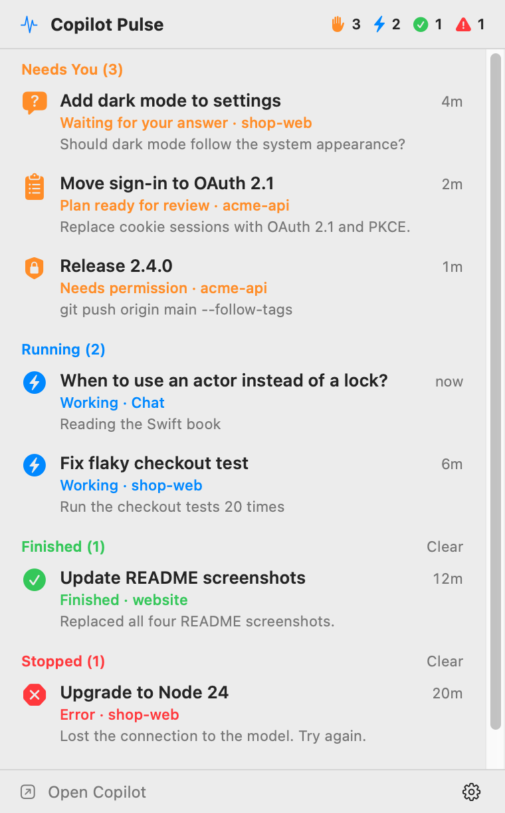
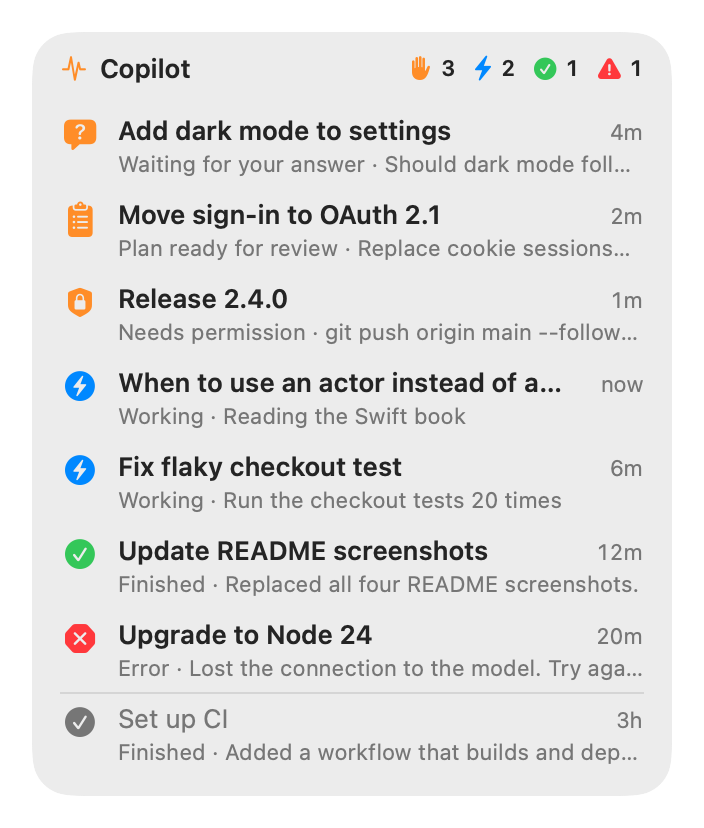

# Copilot Pulse

[](https://github.com/mnsn/copilot-pulse/actions/workflows/ci.yml)
[](LICENSE)

A small macOS menu-bar app with a desktop widget that shows, at a glance, what every
GitHub Copilot app session is doing: which ones are **running**, which **need you**
(a question, a plan to approve or a permission prompt), and which have **finished** or **stopped**.

It updates within a fraction of a second of a state change. It opens the Copilot app's local
files read-only and reacts to file-system events, so it needs no hooks, changes nothing, and
doesn't depend on polling.

<p align="center">
  <picture>
    <source media="(prefers-color-scheme: dark)" srcset="docs/images/menu-dark.png">
    
  </picture>
  &nbsp;
  <picture>
    <source media="(prefers-color-scheme: dark)" srcset="docs/images/widget-large-dark.png">
    
  </picture>
</p>

> [!NOTE]
> Copilot Pulse is an independent project. It isn't affiliated with or endorsed by GitHub.
> The screenshots show made-up sessions from `make demo`.

## What it shows

| Group | Status | When |
|---|---|---|
| **Needs you** | Waiting for your answer | The agent asked a question (choices are shown) |
| | Plan ready for review | The agent finished a plan and waits for approval |
| | Needs permission | A tool call is waiting for your permission |
| **Running** | Working | A turn is in progress (the current step is shown) |
| | Starting… | The app started a turn and the agent hasn't logged anything yet |
| **Done** | Finished | The turn ended normally; shows the agent's summary if there is one |
| **Stopped** | Interrupted | You cancelled the turn |
| | Error | The session failed (the error is shown) |
| | Stopped responding | The log says "mid-turn", the app no longer marks it running, and it has been silent for 90 s |
| **Idle** | Idle | Everything else |

"Needs you" sorts the longest-waiting session first; the other groups show the most recent first.

**Done** and **Stopped** sessions stay highlighted until you've seen them. That happens when:

- you open the session from Copilot Pulse, or click **Clear** on its group in the menu-bar panel,
- you're looking at it in the Copilot app (the app is frontmost and showing that session),
- the Copilot app clears its own unread marker for the session's workspace, or
- the **Keep Finished Sessions For** time passes (1 hour by default).

After that, the session moves to Idle.

## Install

Requirements: macOS 15 or later, and Swift 6. Xcode works, and so do just the Command Line Tools
(`xcode-select --install`).

```sh
git clone https://github.com/mnsn/copilot-pulse.git
cd copilot-pulse
make install     # builds "Copilot Pulse.app", copies it to ~/Applications and launches it
```

`make uninstall` quits the app and removes it.

There's no prebuilt download. The app isn't notarized, so macOS would block a downloaded copy,
while one you build yourself opens normally. It's ad-hoc signed for local use.

Turn on **Launch at Login** in its settings so it's always running. If macOS asks you to allow
it, use **Allow in Login Items Settings…**.

## Using it

- **Menu bar**: the Copilot Pulse icon, followed by a symbol and count for each non-empty group:
  orange ✋ needs you, blue ⚡ running, green ✓ done, red ⚠ stopped. Click it for a panel that
  lists every session by group, with a collapsible Idle section and a gear menu for settings.
- **Desktop widget**: a widget-style panel that lists active sessions first, then the most
  recent idle ones. If they don't all fit, the last row shows "+N more". Drag it by its header,
  and right-click it for settings.
- **Click any session** to open it in the Copilot app (through the app's `ghapp://sessions/<id>` link).

Settings (gear menu or right-click on the widget):

| Setting | Options |
|---|---|
| Show Desktop Widget | on/off |
| Widget Position | **On Desktop (Behind Windows)** like a real widget, or **Floating (Above Windows)** |
| Widget Size | Compact (2 rows), Medium (4), Large (8) |
| Keep Finished Sessions For | 15 minutes, 1 hour, 4 hours, 1 day |
| Launch at Login | on/off |

## Privacy

Copilot Pulse makes no network connections and collects no data. It reads the Copilot app's
files under `~/.copilot` read-only and never changes them. All it stores is its own settings and
which sessions you've cleared, in its preferences on your Mac.

## How it works

The Copilot app already records everything needed, in two places under `~/.copilot`:

| Source | Written by | Provides |
|---|---|---|
| `data.db` (SQLite, WAL mode) | the Copilot app | sessions, names, projects/branches, the "is running" flag, unread markers, the activity feed |
| `session-state/<id>/events.jsonl` | the Copilot agent | a step-by-step log: turns, tool calls, questions, plans, permission prompts, errors |

Copilot Pulse combines the two. The database says which sessions exist and whether the app
thinks they're running. The tail of each log says exactly where a session is, for example
"asked a question at 14:02 and is still waiting".

Both are opened **read-only**. The database uses SQLite's read-only mode, and for the logs only
newly appended bytes are read.

### Updates are pushed, not polled

- **Agent logs** are watched with **FSEvents**. The agent closes `events.jsonl` after every
  append, so each write produces an event (about 0.15 s latency).
- **The app's database** is watched with **kqueue** on `data.db-wal`. This was a key finding:
  FSEvents only reports a file's content changes once the writer **closes** it. The Copilot app
  keeps its SQLite connection open, so its writes to `data.db-wal` produce no FSEvents at all,
  even though the file changes. A kqueue `EVFILT_VNODE` watch reports every write immediately.
  Bursts (one tool call causes about 10 writes) are combined into one reload after 0.25 s.
  When the app quits and SQLite deletes the WAL file, the watch is re-armed as soon as the file
  is recreated. `data.db` itself is deliberately not opened for watching: closing an extra file
  descriptor on a SQLite database drops the process's SQLite locks.

On real data, a session rename (a database-only change) reached the UI about 0.26 s after the
app wrote it.

Two timers exist, and neither drives status updates:

- a 15 s tick that refreshes relative times ("3m") and expires the "keep finished" window, and
- a 60 s safety rescan that catches anything missed, for example after the Mac wakes from sleep.

## Why not a real WidgetKit widget?

WidgetKit widgets are drawn by the system from a timeline, and the system **budgets** how often
they can reload. Per Apple's [Keeping a widget up to date](https://developer.apple.com/documentation/widgetkit/keeping-a-widget-up-to-date),
a frequently viewed widget typically gets 40–70 refreshes a day, "roughly every 15 to 60 minutes".
That is the delay you see with polling-based widgets.

- `WidgetCenter.reloadAllTimelines()` doesn't avoid that. A reload requested by a background app
  counts against the budget. The exceptions are narrow, such as the containing app being in the
  foreground.
- [Widget push updates](https://developer.apple.com/documentation/widgetkit/updating-widgets-with-widgetkit-push-notifications)
  through APNs are "budgeted … and delivered opportunistically" as well. They also need a server,
  push entitlements and a paid developer account.
- Third-party widget hosts such as Pushcut or Scriptable are WidgetKit widgets themselves, so they
  have the same limit. Shortcuts and App Intents run from a script don't avoid it either.

Copilot hooks aren't needed: the app and the agent already write every state change to disk,
so watching those files sees changes without changing any Copilot configuration.

So Copilot Pulse uses a different approach: a borderless, non-activating panel drawn by the app
itself. It sits at desktop level (behind windows, on every Space) and is styled like a macOS
widget. A running app can redraw its own window whenever it likes, so there is no refresh budget.

The trade-offs:

- it isn't in the system widget gallery or Notification Center,
- it doesn't follow the desktop widget tinting, and
- the app must be running (that's what Launch at Login is for).

A WidgetKit extension also needs Xcode to build, and this project builds with the Command Line
Tools alone.

## Command line

The app binary also works as a debugging tool:

```sh
APP="$HOME/Applications/Copilot Pulse.app/Contents/MacOS/CopilotPulse"
"$APP" --dump            # table of every session and its status
"$APP" --json            # the same as JSON, with counts
"$APP" --watch           # print status changes live as they happen
"$APP" --render <dir>    # draw the panel and each widget size (light and dark) to PNGs
```

`make dump`, `make watch` and `make render` do the same from a debug build.
Set `COPILOT_PULSE_COPILOT_DIR` to read a different Copilot data directory.

To see the app's diagnostics:

```sh
log show --last 10m --info --predicate 'subsystem == "com.asaf.CopilotPulse"' --style compact
```

## Development

```text
Sources/PulseCore/      the engine; UI-free, and fully tested
  CopilotPaths          where the app keeps its files
  AppDatabase           read-only SQLite queries (sessions, workspaces, unread markers, activity)
  EventLogReader        reads new lines from the end of events.jsonl
  EventLineParser       turns a JSON line into a LogEvent
  SessionLogState       tracks a session's state from its log events
  StatusResolver        combines database and log state into what the UI shows
  FileEventStream       FSEvents wrapper
  FileWriteWatcher      kqueue watcher for the SQLite WAL file
  SessionEngine         wires it all together and publishes snapshots
Sources/CopilotPulse/   the AppKit/SwiftUI app: menu bar, widget panel, settings, CLI
Tests/PulseCoreTests/   Swift Testing suites, including live FSEvents/kqueue tests on temp files
scripts/                app bundling and signing, the icon, and the demo data
```

```sh
make build         # debug build
make test          # run the tests
make demo          # run the app with made-up sessions in every state (Ctrl-C quits)
make demo-check    # check that the demo sessions land in the expected groups
make screenshots   # render the README screenshots from the demo data
make app           # build "Copilot Pulse.app" into ./build without installing
make icon          # regenerate Resources/AppIcon.icns
```

`make demo` writes a fake Copilot data directory to `build/demo` and points the app at it, so
you can work on the UI without showing your own sessions.

Notes for building with only the Command Line Tools:

- `make test` passes Swift Testing's macro plugin folder to the compiler explicitly. Without it,
  `swift test` sometimes fails with "plugin for module 'TestingMacros' not found".
- The `@State`, `@Entry` and `#Preview` SwiftUI macros aren't available without Xcode, so the
  views use a small `@LocalState` property wrapper instead of `@State`.

## Caveats

- This relies on the Copilot app's **undocumented** local files: the database schema, the event
  log format, and the `ghapp://` link. An app update could change them.
  - If the main database query fails, the app uses a simpler one: session names only, without
    the running flag, projects or branches.
  - If the database can't be read at all, sessions are listed from their log folders, and the
    problem is shown in the panel and the widget.
- Detailed states (questions, plans, permissions, the current step) come from the agent's log on
  this Mac. A session without a local log only shows Running, Interrupted or Idle, based on the
  app's own flags.

## Contributing

Bug reports, ideas and pull requests are welcome. See [CONTRIBUTING.md](CONTRIBUTING.md), and
please report security issues privately as described in [SECURITY.md](SECURITY.md).

When you report a bug, don't paste output from your own sessions: `--dump`, logs and screenshots
include your session names and prompts. Reproducing it with `make demo` is ideal.

## License

Copyright © 2026 Asaf Manassen

Copilot Pulse is free software: you can redistribute it and/or modify it under the terms of the
GNU General Public License as published by the Free Software Foundation, either version 3 of the
License, or (at your option) any later version. It is distributed in the hope that it will be
useful, but WITHOUT ANY WARRANTY; without even the implied warranty of MERCHANTABILITY or FITNESS
FOR A PARTICULAR PURPOSE. See [LICENSE](LICENSE) for details.

GitHub and GitHub Copilot are trademarks of GitHub, Inc.
